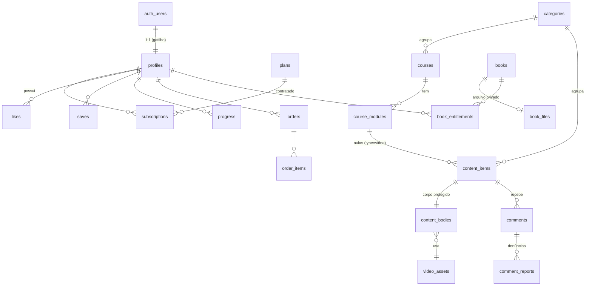

# Arquitetura técnica

## Stack e justificativas

| Camada | Tecnologia | Por que | Alternativa considerada |
|---|---|---|---|
| Aplicação | Next.js 16.4 (App Router, Cache Components, Server Actions), React 19, TypeScript | SSR/streaming para SEO e desempenho no celular; formulários funcionam sem JavaScript; uma base para web + PWA | Remix/React Router (bom, mas menos integrado a PPR e imagens) |
| Estilo | Tailwind CSS 4 com tokens CSS (`src/app/globals.css`) | Design system sem runtime, CSS mínimo | CSS Modules |
| Banco | PostgreSQL 15+ (Supabase gerenciado) | Integridade, RLS, busca em português com `unaccent` + `pg_trgm` | Neon/RDS (compatíveis: o código não usa PostgREST) |
| Acesso a dados | Driver `postgres` com SQL parametrizado | Sem ORM: SQL explícito, revisável e testável; pool compatível com Supavisor (`prepare: false`) | Drizzle (adicionaria camada sem ganho real aqui) |
| Autenticação | Supabase Auth via `@supabase/ssr` (e-mail + senha; código de 6 dígitos por e-mail) | Serviço gerenciado: hashing, limites, recuperação de senha, MFA futuro | Better Auth (mais controle, mais responsabilidade de segurança) |
| Arquivos | Supabase Storage (bucket público para imagens, privado para livros) | Mesmo fornecedor; URLs assinadas de 5 min para livros | Cloudflare R2 |
| Vídeo | Cloudflare Stream (HLS adaptativo + URLs assinadas RS256) | Preço por minuto, sem cobrança de banda, assinatura local do token | Mux (interface pronta em `src/lib/video`, integração não implementada) |
| Pagamentos | Mercado Pago: Assinaturas (`/preapproval`) e Checkout Pro (livros) | Marca conhecida do público; Pix para compras avulsas | Stripe, Asaas, Pagar.me |
| Hospedagem | Vercel (ou qualquer Node 20+) | Deploy simples, cron nativo | Render, Fly.io, VPS |

**Substituição de provedores:** cada integração está atrás de uma interface — `BillingProvider` (`src/lib/billing/types.ts`), `getPlayback()` (`src/lib/video`), `uploadPublicImage/signedPrivateUrl` (`src/lib/storage`), `getSession()` (`src/lib/auth/session.ts`). Telas e regras de acesso não conhecem o fornecedor.

## Fluxo de uma requisição

```
Navegador ──► proxy.ts (renova cookies do Supabase Auth; NÃO autoriza)
          ──► Server Component / Server Action
                 getSession()  → valida JWT (Supabase getClaims) ou cookie HMAC (modo dev)
                 asUser(id, …) → BEGIN; SET LOCAL role authenticated; request.jwt.claims = {sub}
                                 consultas SQL → políticas RLS decidem linhas visíveis
              ◄── HTML em streaming (casca estática + partes dinâmicas em <Suspense>)
```

- `asUser()` executa como o papel `authenticated`/`anon` do Supabase — **o banco aplica RLS mesmo que o código erre**.
- `asSystem()` (conexão privilegiada) é usado somente em: webhooks e reconciliação de pagamento, checkout (após autorização), limite de taxa, leitura de `auth.users` pelo admin.
- O **Data API (PostgREST) do Supabase não é usado**. Recomenda-se removê-lo dos esquemas expostos; mesmo que fique ativo, as políticas e GRANTs explícitos protegem as tabelas (a chave pública é pública por natureza).

## Modelo de dados



Decisões principais:

- **Conteúdo unificado** (`content_items` com `type` = video | short | article | guide): uma única estrutura para busca, curtidas, salvos, comentários e progresso. Aulas de curso são `video` com `module_id`.
- **Separação público × protegido:** `content_items` guarda o que pode ser público (título, resumo, metadados para SEO); `content_bodies` guarda vídeo, passos, texto e transcrição, liberados por `can_access_content()`.
- **Assinatura ≠ posse de livro:** `book_entitlements` registra compras/concessões permanentes; `books.included_in_subscription` define o que a assinatura libera enquanto vigente.
- **Metadados editoriais** em cursos e conteúdos: aplicativo, sistema, versões, data de revisão e situação (`current`/`review_soon`/`outdated`), com tela de revisão no painel.
- **Preço contratado** gravado na assinatura (`subscriptions.price_cents`), independentemente de alterações futuras no plano.
- Migrações versionadas em `supabase/migrations/` (compatíveis com `supabase db push`). Toda tabela nova deve vir com `enable row level security`, `revoke` e `grant` explícitos — no Supabase o esquema `public` concede privilégios amplos por padrão.

## Regras de acesso (no banco)

| Função | Regra |
|---|---|
| `is_admin()` | `profiles.role = 'admin'` (o usuário não consegue alterar `role`: sem GRANT de UPDATE na coluna) |
| `subscription_grants_access()` | `active`: até fim do período + 2 dias · `past_due`: até fim do período + 5 dias (novas tentativas de cobrança) · `canceled`: até o fim do período pago · `pending/paused/expired`: sem acesso |
| `can_access_content(id)` | admin, ou conteúdo publicado e (gratuito ou assinatura válida) |
| `can_comment(id)` | conta conectada + comentários ativos + (admin ou assinatura válida) |
| `can_access_book_file(id)` | admin, ou direito de posse, ou livro incluído na assinatura + assinatura válida |

**Publicação agendada:** `status = 'scheduled'` com `published_at` futuro fica invisível até o horário (`is_live_now`), sem tarefas agendadas.

## Pagamentos (Mercado Pago)

**Assinatura (cartão, renovação automática):**
1. "Assinar" → Server Action valida o plano (ativo e com preço) e cria `subscriptions` *pending* com o preço do momento.
2. `POST /preapproval` (status `pending`, `external_reference` = id interno) → redireciona ao `init_point` do Mercado Pago.
3. O Mercado Pago notifica `/api/webhooks/mercadopago` (`subscription_preapproval`, `subscription_authorized_payment`).
4. O webhook: valida `x-signature` (HMAC-SHA256 do manifesto `id:…;request-id:…;ts:…;`) → grava `billing_events` com chave única (**idempotência**) → **consulta a API** do Mercado Pago (fonte da verdade; o corpo da notificação não é confiável) → aplica `nextStateFromProvider()` (`src/lib/billing/state.ts`).
5. Falhas retornam 500 (o Mercado Pago reenvia) e ficam como `failed`; a **reconciliação** (`/api/cron/reconcile`, de hora em hora) reprocessa falhas, ressincroniza assinaturas e pedidos pendentes e expira cancelamentos vencidos.
6. A página de retorno também consulta a API (nunca confia nos parâmetros da URL).

**Livros (Pix, cartão, boleto via Checkout Pro):** pedido com preço do banco → preferência → notificação `payment` → só libera se **valor e moeda conferem** → estorno/chargeback revoga o direito.

**Limitação conhecida:** pelos documentos públicos consultados (nov/2026), a recorrência automática da API de Assinaturas é por **cartão**. Pix Automático via API não foi confirmado — **[Validar com o Mercado Pago]**. Alternativa sem renovação automática (plano anual pago à vista por Pix) cabe no modelo atual, mas não foi implementada.

## Vídeo

- Produção: Cloudflare Stream com `requireSignedURLs` para aulas pagas. A página da aula só gera o token **depois** que o RLS entregou o `video_asset` (ou seja, a pessoa tem direito). Token RS256 assinado localmente, válido por 3 h.
- Envio pelo painel: *direct creator upload* (o arquivo vai do navegador direto ao Cloudflare).
- Reprodutor próprio (`src/components/player/video-player.tsx`): sem reprodução automática, botões com texto, velocidade, legendas, tela cheia, ±10 s, retomada, gravação de progresso a cada 15 s/pausa/saída, conclusão automática ao alcançar 90% (nunca ao abrir) e botão "Marcar como concluído".
- `provider = 'file'` só serve arquivos em `/demo/` com `DEMO_MEDIA_ENABLED=true`: **não é solução para conteúdo pago**.

## Segurança (referência: OWASP ASVS 4.0 nível 2)

| Controle | Implementação |
|---|---|
| Autenticação | Supabase Auth (JWT verificado no servidor); modo dev bloqueado em produção (`devAuthEnabled()`) |
| Autorização | Verificação em cada página/Server Action/rota + RLS + GRANTs mínimos; admin inexistente (404) para os demais |
| Conteúdo pago | Corpo, vídeo e arquivos só saem do banco/armazenamento com direito de acesso; links temporários |
| XSS | Nenhum HTML vindo do banco é renderizado (somente texto); JSON-LD escapado; CSP; links de materiais restritos a http(s)/internos |
| CSRF | Server Actions do Next.js validam a origem; cookies `SameSite=Lax`; rotas GET não alteram estado |
| Injeção SQL | 100% consultas parametrizadas; tsquery montada só com `[a-z0-9]` |
| Redirecionamento aberto | `safeReturnPath()` aceita apenas caminhos internos |
| Uploads | Tipo detectado pelo conteúdo (magic bytes), limites de tamanho, nomes aleatórios, bucket privado para livros |
| Webhooks | HMAC com comparação em tempo constante, limite de corpo, idempotência, revalidação pela API |
| Rate limiting | Login, cadastro, código por e-mail e recuperação de senha (`hit_rate_limit`); comentários (5/10 min no banco) |
| Golpes/dados pessoais | Comentários com link, CPF, cartão ou códigos de 6 dígitos ficam retidos; aviso antes de publicar |
| Cabeçalhos | CSP, HSTS, `X-Content-Type-Options`, `Referrer-Policy`, `Permissions-Policy`, `frame-ancestors 'none'` |
| Logs | Sem corpo de respostas de provedores nem dados pessoais; payload de webhook minimizado |
| Segredos | Variáveis de ambiente validadas (`src/lib/env.ts`); nada sensível em `NEXT_PUBLIC_*` |

**Limitação aceita:** a CSP usa `'unsafe-inline'` em scripts (exigência do Next.js sem nonce, incompatível com pré-renderização parcial). Mitigação: ausência total de HTML dinâmico. Evolução: CSP com hashes (SRI experimental do Next.js).

## LGPD

- Minimização: cadastro pede só nome/apelido, e-mail e senha; nenhum dado de cartão passa pela plataforma.
- Transparência: política de privacidade (minuta), cookies apenas essenciais.
- Direitos do titular: **baixar meus dados** (`/api/conta/exportar`, JSON) e **pedido de exclusão** com conclusão pelo painel (remove a conta no Supabase Auth e, em cascata, perfil, progresso, salvos e comentários).
- Busca sem resultado é registrada **sem identificar a pessoa**.
- Registro administrativo (`admin_audit_log`) sem dados sensíveis.

## Pontos que exigem validação jurídica antes de vender

1. Termos de uso e política de privacidade (há minutas estruturais em `/termos` e `/privacidade`).
2. Direito de arrependimento (CDC art. 49) e política de reembolso para assinatura e livros digitais.
3. Decreto 7.962/2013 (comércio eletrônico): identificação do fornecedor (razão social, CNPJ, endereço), atendimento.
4. Regras de renovação automática e cancelamento (informação prévia clara — já presente na interface).
5. Prazos de retenção fiscal de registros de pagamento × pedido de exclusão.
6. Nomeação do encarregado (DPO) e lista de operadores de dados (Supabase, Vercel, Cloudflare, Mercado Pago, e-mail).
7. Uso de marcas de terceiros (WhatsApp, Instagram etc.) em títulos e materiais.

## Preparação para o roadmap (sem implementação prematura)

| Recurso futuro | Onde se encaixa |
|---|---|
| Plano familiar / presente | `subscriptions` por pessoa; adicionar `subscription_members` e `provider='gift'` |
| Novos professores | enum `app_role` (`teacher`) + políticas por `created_by` |
| Certificados | `progress.completed_at` por aula já permite calcular conclusão de curso |
| Notificações | service worker já registrado; adicionar Web Push |
| Recomendações personalizadas / IA | `learning_interest`, progresso, curtidas e `search_misses` como sinais |
| Apps nativos | regras de acesso no banco e Server Actions reaproveitáveis via API |
